# F-104A Lateral-Directional Dynamics (Team 15)

Linear state-space modelling, mode identification and simulation of the **Lockheed F-104A Starfighter**
lateral-directional motion at three sea-level flight conditions, in MATLAB/Simulink with an independent
Python cross-check.

| | FC1 | FC2 | FC3 |
|---|---|---|---|
| Mach | 0.257 | 0.80 | 1.10 |
| Trim attitude θe | 2.3° | 2.0° | 1.0° |
| Speed Ve (ft/s) | 286.9 | 893.2 | 1228.1 |
| Dynamic pressure q (lbf/ft²) | 98.0 | 949.3 | 1794.7 |

Task (from `data/team15_problem_statement.pdf`): build the lateral-directional model from the supplied concise
derivatives, find the **Dutch roll, roll subsidence and spiral** modes at each condition, simulate a
β(0) = 2° free response and 2° / 1 s aileron and rudder pulses over 0–20 s, and relate the stability changes to
Mach number and dynamic pressure.

---

## Contents

1. [Headline results](#1-headline-results)
2. [Flight physics in one page](#2-flight-physics-in-one-page)
3. [Equations of motion](#3-equations-of-motion)
4. [The three modes](#4-the-three-modes)
5. [Model matrices](#5-model-matrices)
6. [Results and trends](#6-results-and-trends)
7. [Repository layout](#7-repository-layout)
8. [How to run](#8-how-to-run)
9. [Simulink model and 3D flight animation](#9-simulink-model-and-3d-flight-animation)
10. [Flight animations](#10-flight-animations)
11. [Assumptions and limitations](#11-assumptions-and-limitations)
12. [References](#12-references)

---

## 1. Headline results

| | FC1 (M 0.257) | FC2 (M 0.80) | FC3 (M 1.10) |
|---|---|---|---|
| **Dutch roll** eigenvalue (1/s) | **+0.0722** ± 2.0945j | −0.3826 ± 4.4874j | −0.5527 ± 7.5139j |
| damping ratio ζ | **−0.034 (unstable)** | 0.085 | 0.073 |
| natural frequency ωn (rad/s) | 2.10 | 4.50 | 7.53 |
| period (s) | 3.00 | 1.40 | 0.84 |
| **Roll subsidence** root (1/s) | −1.860 | −4.818 | −7.861 |
| time constant τ (s) | 0.538 | 0.208 | 0.127 |
| **Spiral** root (1/s) | **+0.00082 (divergent)** | −0.00724 | −0.00418 |
| time to double / half | 850 s (double) | 96 s (half) | 166 s (half) |

* The Dutch roll is **lightly damped everywhere** (ζ < 0.09) and **slightly unstable at FC1** (low speed, low q).
* Roll subsidence gets much faster with speed: τ falls from 0.54 s to 0.13 s.
* The spiral is **nearly neutral** in all cases; only FC1 diverges, and so slowly (doubling in ~14 minutes) that a pilot can easily correct it.
* The MATLAB results (`FCn_all_cases.m`) and the Python reference (`python/f104_reference.py`) agree to every printed digit.

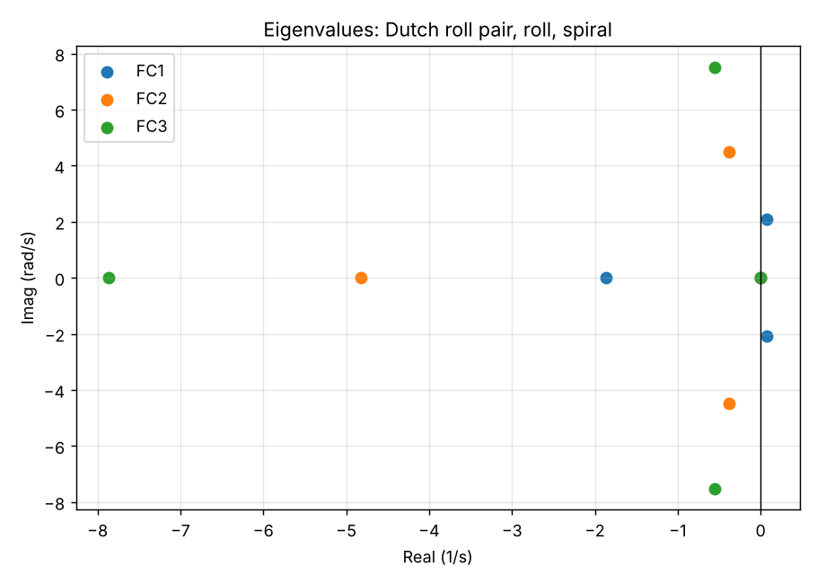

---

## 2. Flight physics in one page

An aircraft in steady level flight has six degrees of freedom. For small disturbances the motion **separates into two
independent sets**:

* **Longitudinal**: pitch, speed, climb (symmetric motion).
* **Lateral-directional** (this project): **sideslip β, roll rate p, yaw rate r, bank angle φ** (asymmetric motion).

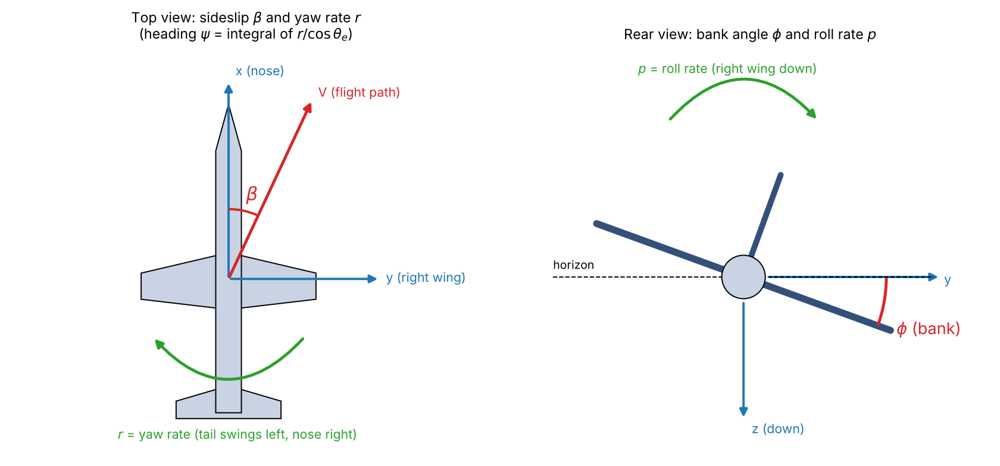

| Symbol | Meaning | Positive when |
|---|---|---|
| **β** | sideslip angle: angle between the flight path V and the nose | airflow arrives from the right |
| **p** | roll rate about the body x-axis | right wing goes down |
| **r** | yaw rate about the body z-axis | nose swings right |
| **φ** | bank (roll) angle, φ̇ ≈ p | right wing down |
| **ψ** | heading, ψ̇ = r / cos θe (not needed in the 4-state model) | nose right of north |
| **ξ, ζ** | aileron and rudder deflection (inputs) | per the derivative table |

**What makes the motion happen**, in plain language:

* **Weathercock stability (nβ > 0).** Sideslip makes the fin and fuselage yaw the nose back into the wind. This sets the Dutch roll frequency.
* **Dihedral effect (lβ < 0).** Sideslip rolls the aircraft away from the sideslip direction. This couples yaw to roll and is the reason the Dutch roll rocks the wings.
* **Roll damping (lp < 0).** A rolling wing sees changed angle of attack, producing a restoring moment. This gives the fast roll subsidence.
* **Yaw damping (nr < 0).** Fin and fuselage resist yawing.
* **Cross-couplings (lr, np).** Yaw rate rolls the aircraft; roll rate yaws it (adverse yaw). They shape the spiral mode.
* **Gravity.** A banked aircraft has a sideways weight component, which appears as the (g cos θe / Ve)·φ term in the β equation.

**Why Mach number and dynamic pressure matter.** Aerodynamic forces and moments scale with q = ½ρVe². From FC1 to FC3
the dynamic pressure rises 18× and the control and stability derivatives grow roughly in proportion, so the
natural frequencies and control power rise sharply, while the *damping* derivatives grow more slowly.
That is why the modes get faster with speed but the Dutch roll stays only lightly damped.

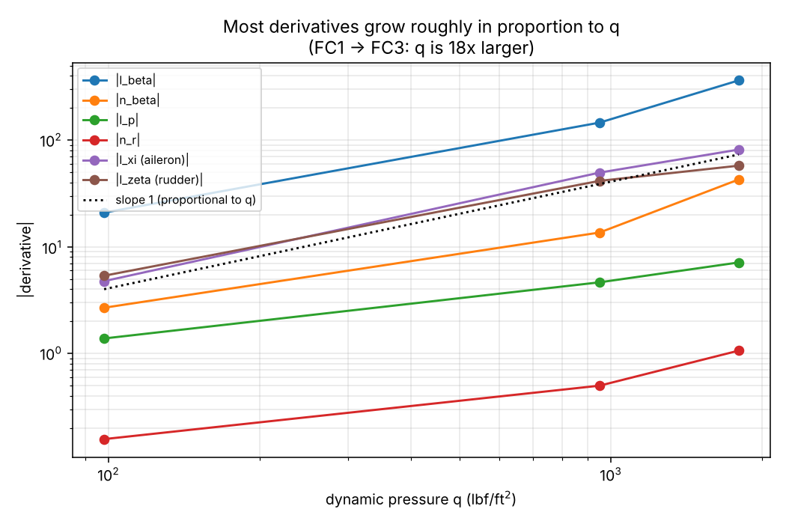

---

## 3. Equations of motion

Small perturbations about steady, straight, level flight at speed Ve and pitch attitude θe, with the concise
(normalised) derivatives of the problem statement. Side force is divided by mass; rolling and yawing moments by
inertia (with the product of inertia absorbed). β is used as the state, so lβ and nβ carry units of 1/s².

**Side force (sideslip) equation**

$$\dot\beta = y_v\,\beta + \sin\theta_e\,p - \cos\theta_e\,r + \frac{g\cos\theta_e}{V_e}\,\phi + y_\xi\,\xi + y_\zeta\,\zeta$$

**Rolling moment equation**

$$\dot p = l_\beta\,\beta + l_p\,p + l_r\,r + l_\xi\,\xi + l_\zeta\,\zeta$$

**Yawing moment equation**

$$\dot r = n_\beta\,\beta + n_p\,p + n_r\,r + n_\xi\,\xi + n_\zeta\,\zeta$$

**Kinematics (Euler angle rate, with the heading eliminated)**

$$\dot\phi = p + \tan\theta_e\,r$$

What each term in the β equation is doing:

* `yv·β`: side force from sideslip (fin and fuselage resist sideslip, so yv < 0).
* `sinθe·p − cosθe·r`: pure geometry. Rotating the airframe changes which way the flight path points relative to the body. The −cosθe·r term is the dominant one: yawing right swings the nose right, so the relative wind comes from the left (β decreases).
* `(g cosθe / Ve)·φ`: gravity pulls a banked aircraft sideways, driving sideslip.

### State-space form

With state **x** = [β p r φ]ᵀ and input **u** = [ξ ζ]ᵀ (radians), output **y** = x (C = I, D = 0):

$$\dot{\mathbf x} = A\mathbf x + B\mathbf u,\qquad
A=\begin{bmatrix}
y_v & \sin\theta_e & -\cos\theta_e & \dfrac{g\cos\theta_e}{V_e}\\
l_\beta & l_p & l_r & 0\\
n_\beta & n_p & n_r & 0\\
0 & 1 & \tan\theta_e & 0
\end{bmatrix},\quad
B=\begin{bmatrix}
y_\xi & y_\zeta\\ l_\xi & l_\zeta\\ n_\xi & n_\zeta\\ 0 & 0
\end{bmatrix}$$

### Stability analysis

The modes are the eigenvalues of A (roots of det(λI − A) = 0). For a complex pair λ = σ ± jωd:

$$\omega_n = |\lambda| = \sqrt{\sigma^2+\omega_d^2},\qquad \zeta = -\frac{\sigma}{\omega_n},\qquad T = \frac{2\pi}{\omega_d}$$

For a real root: time constant τ = −1/λ; time to half (or double) = ln 2 / |λ|. The aircraft is stable if
every eigenvalue has a negative real part.

**Handy checks** (they hold for every case in this repo):

* Roll subsidence root ≈ **lp** (FC2: −4.64 vs −4.82 exact).
* Dutch roll ωn is of the order of **√nβ** (FC2: 3.69 vs 4.50 exact; the approximation is 10 to 25% low).
* The determinant gives the spiral root exactly from the other three: **λspiral = det(A) / (λroll · ωn²)**, because the product of all four eigenvalues equals det(A).

---

## 4. The three modes

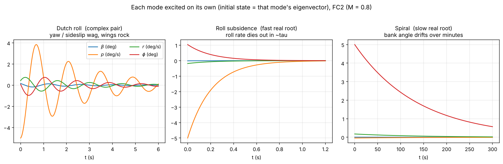

| Mode | Eigenvalue type | What the aircraft does | Typical size here |
|---|---|---|---|
| **Dutch roll** | complex pair | Nose wags (yaw and sideslip) while the wings rock, in an oscillation. Mainly a β–r–p coupling. Annoying to fly and a stability concern when poorly damped. | period 0.8 to 3 s, ζ from −0.03 to 0.09 |
| **Roll subsidence** | large negative real root | Roll rate decays exponentially after an aileron input; a first-order lag in p. | τ from 0.13 to 0.54 s |
| **Spiral** | small real root (near zero) | Very slow drift in bank and heading. If unstable, a wing-down disturbance grows into a steepening turn. | doubling or halving over 1 to 14 min |

**How the code classifies them** (`classify_modes` in every script): the complex pair is the Dutch roll;
of the two real roots, the more negative one is roll subsidence and the other is the spiral.

---

## 5. Model matrices

Numbers below are the A and B matrices actually used (rows β, p, r, φ).

**FC1 (M = 0.257, θe = 2.3°)**

```
A = [ -0.1780   0.0401  -0.9992   0.1121        B = [ 0       0.0317
     -20.900   -1.3800   1.1600   0                    4.76    5.35
       2.680   -0.0993  -0.1570   0                    0.266  -0.923
       0        1.0000   0.0402   0     ]             0       0      ]
```

**FC2 (M = 0.80, θe = 2.0°)**

```
A = [ -0.4520   0.0349  -0.9994   0.0360        B = [ 0       0.0719
     -146.00   -4.6400   3.6700   0                    49.6    41.5
      13.600   -0.1880  -0.4980   0                    3.51   -7.07
       0        1.0000   0.0349   0     ]             0       0      ]
```

**FC3 (M = 1.10, θe = 1.0°)**

```
A = [ -0.7910   0.0175  -0.9998   0.0262        B = [ 0       0.0621
     -363.00   -7.1200   7.1700   0                    81.5    57.6
      42.700   -0.3410  -1.0600   0                    6.5    -8.72
       0        1.0000   0.0175   0     ]             0       0      ]
```

Constants: g = 32.2 ft/s², ρ = 0.00238 slug/ft³, a₀ = 1116.44 ft/s, Ve = M·a₀. The aileron side-force derivative yξ is zero.
Inputs are in radians; plots are in degrees.

---

## 6. Results and trends

**Time histories** (β, p, r, φ for free response, aileron pulse and rudder pulse; 0–20 s):

| FC1 | FC2 | FC3 |
|---|---|---|
| 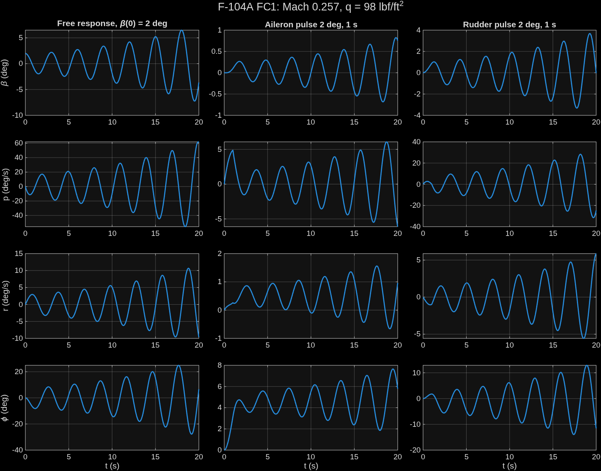 | 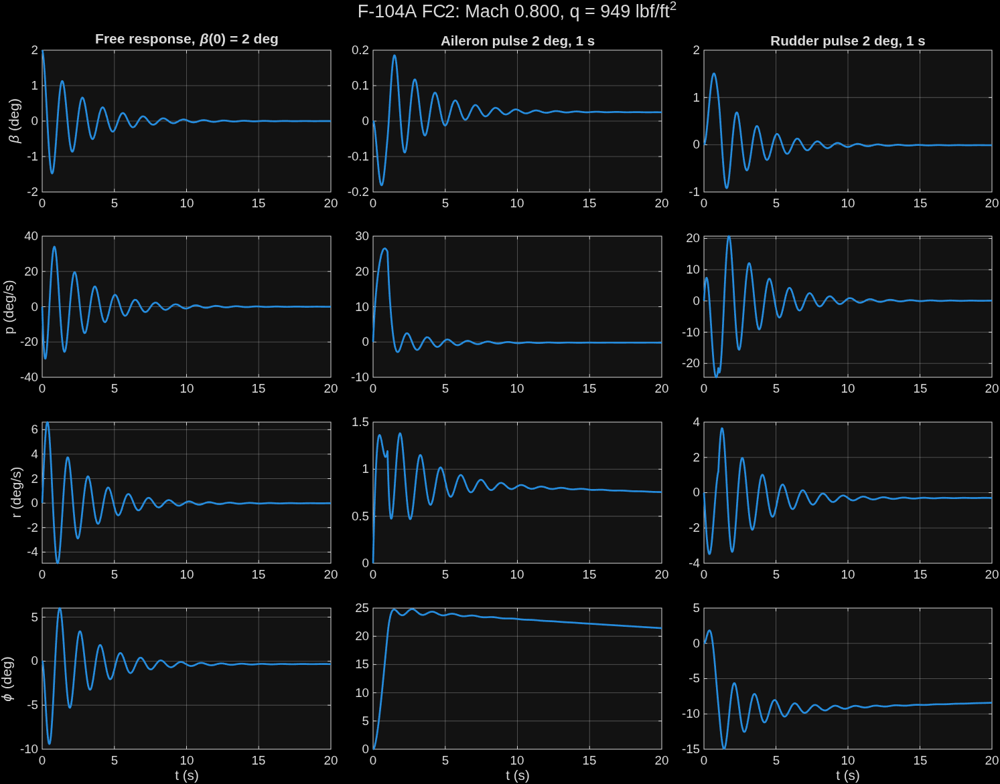 | 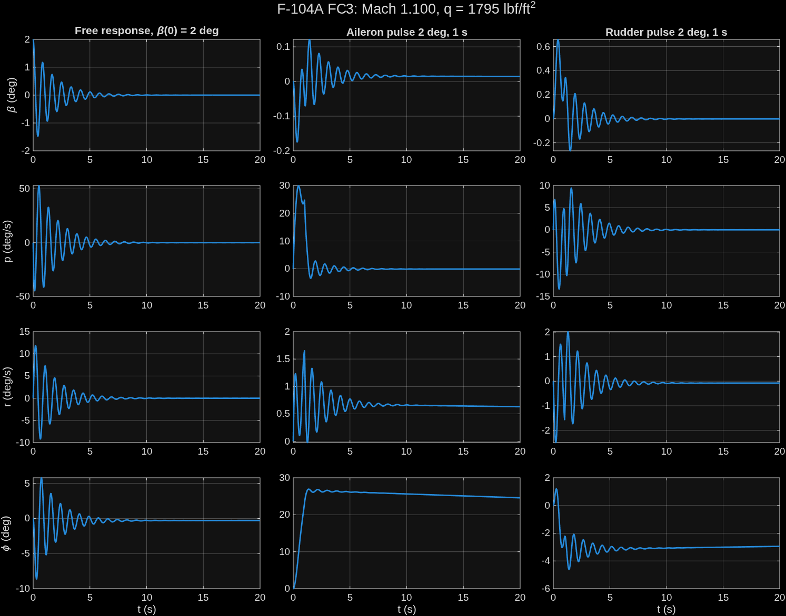 |

**Mode comparison versus Mach number and dynamic pressure:**

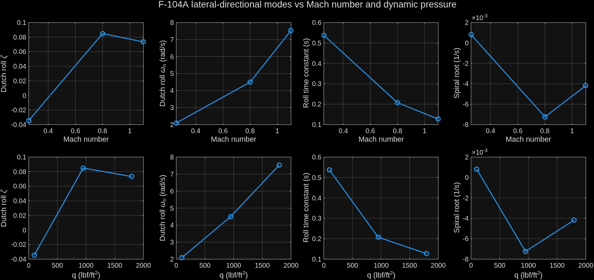

**Interpretation**

1. **Dutch roll damping stays low.** ζ never exceeds ~0.09. It is slightly negative at FC1, where the low dynamic pressure gives weak damping derivatives (nr, lp) compared with the cross-couplings. A stability-augmentation system (yaw damper) would normally be needed.
2. **Frequency and speed of response rise with speed.** ωn grows from 2.1 to 7.5 rad/s, roughly following √nβ, and nβ itself grows with q.
3. **Roll subsidence gets more than 4× faster** (τ 0.54 s → 0.13 s) because lp becomes much larger in magnitude with speed.
4. **The spiral is nearly neutral** and its sign depends on the balance of lβ·nr against nβ·lr; it is the only mode that flips sign (unstable at FC1, stable at FC2 and FC3).
5. **Peak responses** (from `results/csv/F104_peak_values.csv`): in the FC1 free response β grows from 2° to 7.2° and φ reaches ~28°, which is large enough that the linear model is questionable (see [limitations](#11-assumptions-and-limitations)).

Numerical tables: `results/csv/F104_mode_summary.csv` and `results/csv/F104_peak_values.csv`.

---

## 7. Repository layout

```
F104-lateral-directional/
├── README.md
├── requirements.txt
├── .gitignore
├── data/
│   └── team15_problem_statement.pdf     derivative table and simulation commands
├── matlab/
│   ├── setup_paths.m                    run once per session
│   ├── flight_conditions/
│   │   ├── FC1_all_cases.m              model + modes + 3 simulations + plots, FC1
│   │   ├── FC2_all_cases.m
│   │   └── FC3_all_cases.m
│   ├── comparison/
│   │   └── F104_mode_comparison.m       all three FCs: mode table, trend charts, CSVs
│   └── simulink/
│       ├── F104_build_model.m           programmatically builds the Simulink model
│       ├── F104_add_visualization.m     adds the flight-animation signal path
│       ├── F104_lateral.slx             generic model
│       └── F104_FC1_sim.slx  F104_FC2_sim.slx  F104_FC3_sim.slx
├── python/
│   ├── f104_reference.py                independent cross-check (numpy/scipy)
│   └── make_explainer_figures.py        regenerates docs/images/*
├── results/
│   ├── csv/                             mode summary, peak values
│   └── figures/
│       ├── matlab/                      figures produced by the MATLAB scripts
│       └── python/                      figures produced by the Python reference
└── docs/
    ├── MEDIA_GUIDE.md                   what screenshots and videos to capture, and how
    ├── images/                          explanatory figures and Simulink screenshots
    └── videos/                          flight-animation recordings
```

---

## 8. How to run

**MATLAB** (Simulink needed for the `.slx` models; the `*_all_cases.m` scripts run the analysis directly):

```matlab
cd <repo>/matlab
setup_paths                          % add sub-folders to the path
cd flight_conditions
FC1_all_cases                        % repeat for FC2 and FC3
cd ../comparison
F104_mode_comparison                 % comparison plot + CSVs
```

The scripts save their figures and `.mat` files in MATLAB's *current folder*; move the figures you want to keep
into `results/figures/matlab/`.

**Python** (no MATLAB needed):

```bash
pip install -r requirements.txt
python python/f104_reference.py            # mode table + figures -> results/figures/python/
python python/make_explainer_figures.py    # teaching figures -> docs/images/
```

---

## 9. Simulink model and 3D flight animation

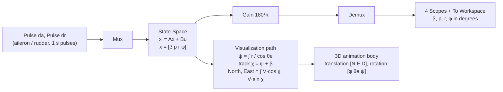

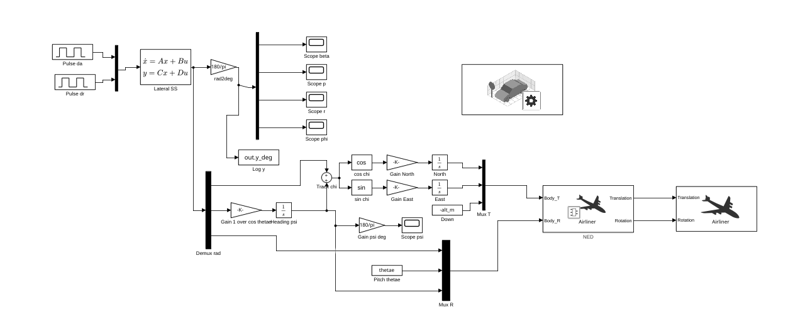

* `F104_build_model.m` builds the model from code: two Pulse Generators → Mux → State-Space → rad-to-deg Gain → Demux → four Scopes, plus a To Workspace log. The block parameters are **workspace variables** (`A, B, C, D, x0, ail_amp, rud_amp`), so one model serves every flight condition and input case.
* `F104_add_visualization.m` adds the animation signal path: heading ψ = ∫ r/cos θe, track χ = ψ + β, North/East position integrals, and the translation and rotation vectors for the 3D body. It also needs `thetae`, `V_ms`, `alt_m` and `pos_scale` in the workspace (`pos_scale = 0` shows attitude only, `1` flies the ground track). The three 3D blocks are added by hand; the function prints the steps when it finishes. The 3D body is the Airliner model from the animation pack, used as a **stand-in for the F-104** (only attitude and track are driven by the simulation, not the airframe shape).
* Typical sequence: build model → set the workspace variables for a flight condition → add visualization → run.

---

## 10. Flight animations

3D animation of the FC1 (M = 0.257) simulation, driven by the Simulink model's state history. FC1 is the
interesting case because its Dutch roll is slightly unstable. Full-quality MP4s are in `docs/videos/`.

| Input | Animation | Video |
|---|---|---|
| **Initial sideslip** β(0) = 2°, no control input | 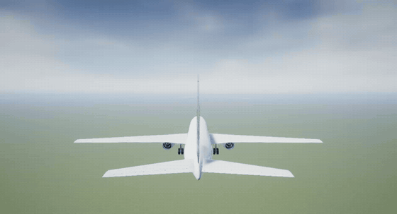 | [MP4](docs/videos/FC1_free_response_initial_sideslip.mp4) |
| **Rudder pulse** 2° for 1 s | 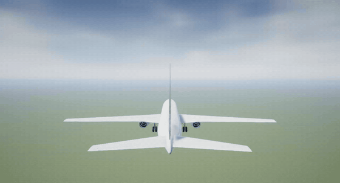 | [MP4](docs/videos/FC1_rudder_pulse.mp4) |
| **Aileron pulse** 2° for 1 s | 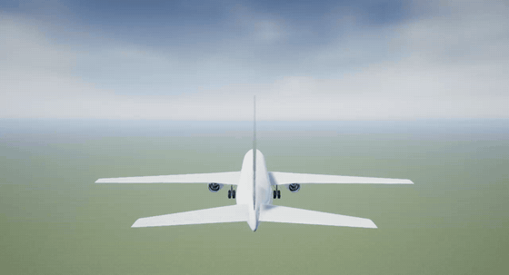 | [MP4](docs/videos/FC1_aileron_pulse.mp4) |

### Which modes each animation shows

FC1 modes (from section 1): **Dutch roll** +0.0722 ± 2.0945j 1/s (period 3.0 s, ζ = −0.034, amplitude doubles
every 9.6 s), **roll subsidence** −1.860 1/s (τ = 0.54 s), **spiral** +0.0008 1/s (doubling time ~850 s).
The mode content below is read from the FC1 time histories and the eigenvalues in section 6; it describes what the
motion should look like.

| Animation | Dutch roll (period ≈ 3 s) | Roll subsidence (τ ≈ 0.5 s) | Spiral (≈ 850 s) |
|---|---|---|---|
| **Initial sideslip** | **Dominant.** The 2° sideslip starts a nose-wag and wing-rock oscillation that grows each cycle (β reaches ~7° and bank ~25° by 20 s). About 6 to 7 cycles in the run. | Present only as a fast damping of the roll rate inside each oscillation; no separate motion. | Not visible: far too slow for a 20 s run. |
| **Rudder pulse** | **Dominant.** The 1 s rudder kick yaws the nose and builds sideslip, which excites the Dutch roll directly; the oscillation then grows (β up to ~4°, bank ~±13°). | A quick roll response to the rudder (roll due to yaw and sideslip) that settles within about a second before the Dutch roll takes over. | Not visible. |
| **Aileron pulse** | Appears after the pulse as a small growing wag (β only ~1°) superimposed on the roll. | **Clearly visible in the first ~2 s:** the roll rate builds up while the aileron is on, then dies out with τ ≈ 0.5 s, leaving the aircraft banked (~4 to 5°). | The bank angle that remains after the roll is the start of the spiral mode; its slow divergence is not visible in 20 s. |

**How to read them.** The rapid roll-and-settle in the aileron animation is *roll subsidence*; the repeating
nose-wag with wing-rock is the *Dutch roll*; the spiral only shows up as a persistent bank angle that never returns
to level. Compare each clip with the matching column of `results/figures/matlab/F104_FC1_time_histories.png`.

FC1 is shown as the representative case, since the animation set-up is identical for every condition (only the
workspace variables change). Note that FC2 and FC3 do **not** behave like FC1: their Dutch roll is damped, so the
oscillations die out within a few seconds instead of growing (see the time histories above).

**Optional additions** (see [`docs/MEDIA_GUIDE.md`](docs/MEDIA_GUIDE.md)): a Simulink scopes screenshot for FC1, and
FC2 / FC3 animations for a side-by-side speed comparison.

---

## 11. Assumptions and limitations

* Small-disturbance linear model about steady level flight; valid only for small angles. The FC1 free response reaches ~28° of bank, beyond what the linear model can be trusted for.
* Rigid airframe, constant mass, constant speed, no longitudinal coupling, no atmospheric turbulence.
* Concise (reduced) derivatives only: no yp / yr side-force terms; yξ = 0.
* Open-loop airframe: no stability augmentation or autopilot, unlike a real operational aircraft.
* Compressibility enters only through the supplied derivative values at each Mach number.
* Only three points per trend plot, so lines on the trend charts are guides, not fitted curves.

## 12. References

* M. V. Cook, *Flight Dynamics Principles: A Linear Systems Approach to Aircraft Stability and Control*, 2nd ed., Butterworth-Heinemann (source of the equations of motion and the concise derivative form).

